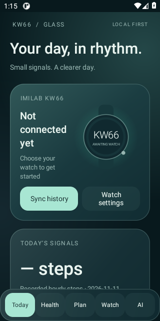
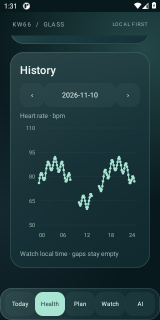
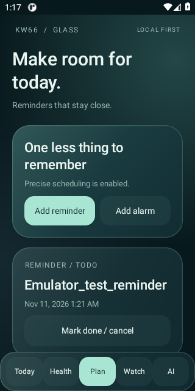

# KW66 Glass

**An independent, native Android companion for the IMILAB KW66.**

Connect your watch, forward phone notifications, view health-history graphs, send custom messages, and schedule reminders and alarms. An optional build adds an on-demand, on-device Gemma AI companion.

[Download APKs](https://github.com/istiaqueahmedarik/IMILAB-KW66/releases) · [Feature audit](docs/FEATURE-AUDIT.md) · [Call support](docs/CALLS.md) · [AI companion](docs/AI-COMPANION.md)

> **Experimental preview.** Both APK variants build and pass Android lint with zero errors. Core navigation, history graphs and basic reminder persistence have been checked in an Android emulator. This is **not yet a fully device-verified GloryFit replacement**: physical BLE/background behavior, call actions, real sleep stages and AI inference still need testing on the target phone/watch.

## Screenshots

Native Android emulator screenshots. Graph values and the reminder below are **synthetic demonstration data**, not health measurements. Demo data is not included in the APK.

<table>
  <tr>
    <td></td>
    <td></td>
    <td></td>
  </tr>
  <tr><td>Today</td><td>Health history</td><td>Reminders and todos</td></tr>
</table>

## What it can do

| Feature | Implemented behavior |
|---|---|
| **Native glass-style interface** | Today, Health, Plan, Watch and AI screens, built with Android views and Canvas. No WebView. |
| **BLE connection and reconnect** | Select a KW66, keep the link in an Android foreground service, retry unexpected disconnects with backoff, and restore connection intent after reboot. An explicit Disconnect pauses reconnect. |
| **Current/latest readings** | Numeric values with timestamps. Fresh live heart-rate packets are preferred when available; older readings are labeled as recorded data. |
| **Health-history graphs** | Hourly step bars, HR/SpO₂ time series and raw sleep-stage plots. Browse recorded days or pick a date. Missing samples remain gaps; no text-card history lists. |
| **Phone notifications** | Forward notifications from all apps after enabling Android notification access and the app's forwarding switch. Exclude individual apps or pause forwarding. Android may hide sensitive content. |
| **Custom watch messages** | Send UTF-16BE messages with a vibration request. Text is limited to 240 encoded bytes; actual character/font rendering depends on watch firmware. |
| **Reminders and scheduled todos** | Choose a future date/time; repeat hourly, daily or weekly. A delivered one-shot todo remains visible until marked done. Both phone alerts and watch messages are supported. |
| **Alarm until stopped** | Phone alarm sound loops and watch nudges repeat every 30 seconds while the service is running, until stopped inside the app. Active state is persisted. |
| **Cellular/phone calls** | Android 12+ wearable companion association and Telecom `InCallService` integration: caller information and applicable phone-app answer, reject or hang-up controls. The existing system dialer remains in place. |
| **WhatsApp and Messenger calls** | Detect their call notifications and expose the actions those notifications actually provide. No hidden VoIP APIs or guessed button semantics. |
| **Watch hang-up** | Optional mapping for the source-derived `D1 02` event, with a unique-call check before reject/hang-up. An actual KW66 answer event has **not** been established. |
| **Watch tools** | Explicit clock sync, find-watch vibration and optional music play/pause/next/previous/volume actions. |
| **Private local data and export** | App-private SQLite storage. Export decoded health records, todos and bounded diagnostics to a JSON file you select. Notification text and live caller handles are excluded from exports and AI context. |
| **Optional local AI** | Import a compatible `.litertlm` model. Share only selected health/todo/watch context; use text or tap-to-talk; optionally read replies aloud. The model can propose a watch message, history sync or todo for you to apply. |

These are implemented capabilities, not a claim that every command works on every KW66 firmware. The protocol was developed from reviewed GloryFit/Gadgetbridge code and saved KW66 traffic. See the [complete feature audit](docs/FEATURE-AUDIT.md) for evidence and unsupported features.

## Install

Download an APK from [Releases](https://github.com/istiaqueahmedarik/IMILAB-KW66/releases):

| Build | Requirements | Choose it when… |
|---|---|---|
| [**Core APK**](https://github.com/istiaqueahmedarik/IMILAB-KW66/releases/download/v0.1.0-preview.1/kw66-glass-core-debug.apk) | Android 8.0+ and Bluetooth LE | You want the watch companion without an AI inference runtime. |
| [**Gemma APK**](https://github.com/istiaqueahmedarik/IMILAB-KW66/releases/download/v0.1.0-preview.1/kw66-glass-gemma-debug.apk) | Android 12+, arm64-v8a | You also want local AI. Model weights are **not** bundled; import them separately. |

These are sideloadable **debug preview APKs**, not Play Store releases. The Gemma OS/ABI requirements do not guarantee a particular model fits or runs well on a phone.

Open the downloaded APK on your phone and allow installation from the source you chose. Alternatively, with an authorized USB-debugging phone:

```bash
adb devices -l
bash scripts/install.sh YOUR_PHONE_SERIAL core
# Or: bash scripts/install.sh YOUR_PHONE_SERIAL gemma
```

The script installs the locally built APK on the explicit serial. Core and Gemma use the same application ID; installing the other variant replaces the current app when signed with the same key. Installing an update does not require clearing app data.

## First-time setup

1. **Disconnect other watch clients.** Release the KW66 connection in GloryFit, Hello Imilab, nRF Connect or a browser BLE logger. Their saved data does not need to be deleted.
2. **Connect the watch.** Open **Watch**, grant the requested Nearby devices permission, and select your KW66. Older Android versions require location permission for BLE scanning; the app does not read GPS.
3. **Enable notifications.** Grant Android notification access, then switch on **Forward all app notifications**. Some phones require **Allow restricted settings** in app info for sideloaded apps before notification access can be enabled.
4. **Allow precise reminders.** In **Plan**, enable **Alarms & reminders** access. Without it, Android's inexact scheduling may deliver late.
5. **Fetch history.** Use the Health tabs to fetch steps, HR, SpO₂ or sleep separately. The graph opens on the latest recorded day. Watch-local timestamps can differ from the phone's clock.
6. **Enable calls only if wanted.** Turn on **Call alerts & phone controls**. Cellular control additionally needs Android's watch association approval; WhatsApp/Messenger need notification access and exposed call actions. Watch hang-up is a separate opt-in.
7. **Review background settings.** If your phone stops the companion, check its app battery/background settings. Keep the connection notification available.

Start with battery/version and a short custom message. A completed Bluetooth write does **not** prove that the watch displayed a message or performed an action.

## Health graphs

- **Steps:** hourly bars; recorded zeroes have baseline markers.
- **Heart rate / SpO₂:** individual samples and time-series lines; missing samples are not joined across gaps.
- **Sleep:** recorded raw stage codes. Stage names, duration units and midnight interpretation still need real-watch validation; no sleep score or medical interpretation is invented.

Latest numeric values remain separate from the historical date you select. Readings are watch-reported estimates, not clinical measurements. [More screenshots and graph details →](docs/GRAPHS.md)

## Calls: what is and is not supported

**Phone-app controls:** Android's wearable-companion route can provide Telecom call handles without making this app the default dialer. WhatsApp/Messenger controls depend on their current notification format and the actions they expose. Missing actions stay unavailable; dismissing a notification is not the same as rejecting a call. Notification-based actions require an unlocked phone in this implementation.

**Watch controls:** `D1 02` is a reviewed hang-up/reject candidate, guarded against ambiguous call targets. It still needs physical watch validation. There is no established watch-side answer command/event, so answering from the KW66 is not promised.

There is no call recording, call audio interception, watch audio routing, automatic call answering or accessibility-based tapping. [Compatibility and test checklist →](docs/CALLS.md)

## Optional Gemma companion

The Gemma build uses **LiteRT-LM 0.18.1**. Start with a compatible [Gemma 4 E2B `.litertlm` model](https://huggingface.co/litert-community/gemma-4-E2B-it-litert-lm); GGUF and safetensors files are not interchangeable with that format.

- Health, todo and watch context each have a separate switch, initially off.
- Notification bodies, live caller details, contacts and other app databases are not supplied to the AI.
- The engine loads for a request and closes afterward. Leaving AI requests cancellation; native model initialization may have to finish before cleanup can occur.
- Generated actions are restricted and field-checked. They run only when you tap **Apply proposed action**.
- Voice input and speech output use the installed Android providers. An offline preference is requested for speech recognition, but a provider may use its network service. There is no always-listening microphone.

Gemma 4 E2B availability is verified; inference, peak RAM, unloading, heat and battery cost in this app have **not** been measured on a physical phone. Smaller encodings and model-only memory claims do not establish total app RAM requirements. [Model sources, licensing and alternatives →](docs/AI-COMPANION.md)

## Build from source

The bootstrap script supports Linux x86_64 with Bash, Git, Python 3.12+ and network access, and keeps tools inside the checkout:

```bash
git clone https://github.com/istiaqueahmedarik/IMILAB-KW66.git
cd IMILAB-KW66
bash scripts/build.sh core
# Optional:
bash scripts/build.sh gemma
```

It provisions JDK 21 if needed (Temurin, then Corretto fallback), Gradle 8.13, Android API 36 and build tools 35.0.0. JDK/Gradle downloads are verified against published SHA-256 values. SDK licenses are presented when packages need installing. No sudo is used. You can supply an existing supported JDK with `JAVA_HOME` and an existing SDK with `ANDROID_HOME`.

Build outputs:

```text
app/build/outputs/apk/core/debug/app-core-debug.apk
app/build/outputs/apk/gemma/debug/app-gemma-debug.apk
```

A standard Gradle wrapper is included for Android Studio and direct Gradle use (`./gradlew :app:assembleCoreDebug :app:lintCoreDebug`) once a compatible JDK and Android SDK are configured.

The project pins AGP 8.13.2, Kotlin 2.3.0 and JVM bytecode target 17. Android Studio users can import the project and select the coreDebug or gemmaDebug variant with a compatible Gradle/JDK setup. Release signing is not configured; keep any signing keys private.

## Tests and verification

```bash
bash scripts/test.sh
```

The public tests are self-contained and use synthetic protocol fixtures. They cover decoding boundaries, malformed packets, Unicode chunking, schedule math, call-target policy, SQLite constraints/expiry and toolchain fallback. Optional private-capture replay is supported with `KW66_REPLAY_CAPTURE=/path/to/capture.jsonl`; personal captures are not part of this repository.

| Check | Result |
|---|---|
| Core and Gemma APK assembly | Passed locally |
| Android lint, both variants | Zero errors; nonfatal warnings remain |
| APK signatures | Verified debug signatures |
| Standalone host assertions / malformed packets | 131 assertions passed; 10,000 malformed-packet trials |
| Private saved-capture replay during development | 403 packets replayed; underlying capture is not published |
| Native core emulator | Five screens, four graph types, date navigation, empty graph, reminder creation/persistence/completion checked |
| Physical BLE, background survival, notification display and calls | Still needs target phone/watch acceptance tests |
| Real sleep semantics and local AI inference/power | Still unverified |

### Practical limits

- Force-stop, permission revocation, Bluetooth off, reboot and aggressive vendor battery policies can interrupt background behavior.
- If the phone/watch is disconnected, watch notifications cannot be guaranteed. Ordinary messages expire after 15 minutes; live call alerts expire after 10 seconds. The queue is bounded.
- Full history fetches wait for matching end markers. A 45-second timeout pauses the sync and reports incomplete data instead of calling it successful.
- Phone alarm audio cannot continue through a reboot/force-stop. On recent Android versions a rebooted active alarm posts a resume notification; opening the app resumes ringing or lets you stop it.
- Daily/weekly reminders use fixed 24-hour/7-day periods, not daylight-saving-aware calendar recurrence.
- No firmware flashing, factory reset, raw accelerometer/PPG stream or AI execution on the watch is implemented.

## Project layout

```text
app/src/main/          Android UI, BLE service, protocol, storage, charts and calls
app/src/core/          Lightweight build without local inference
app/src/gemma/         Optional LiteRT-LM adapter
scripts/               Build, install and diagnostic helpers
tests/                 Public synthetic/offline host tests
docs/                  Architecture, compatibility notes and emulator screenshots
```

[Architecture](docs/ARCHITECTURE.md) · [Feature audit](docs/FEATURE-AUDIT.md) · [Validation](docs/VALIDATION.md)

## License and acknowledgments

AGPL-3.0-or-later; see [LICENSE](LICENSE) and [NOTICE](NOTICE). The protocol implementation was informed by reviewed Gadgetbridge/GloryFit source and local KW66 experiments. AndroidX Core and optional Google LiteRT-LM retain their Apache-2.0 licenses. Model weights are not included and retain their own licenses.

This project is independent and is not affiliated with or endorsed by IMILAB, GloryFit, Gadgetbridge or Google.
